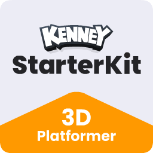
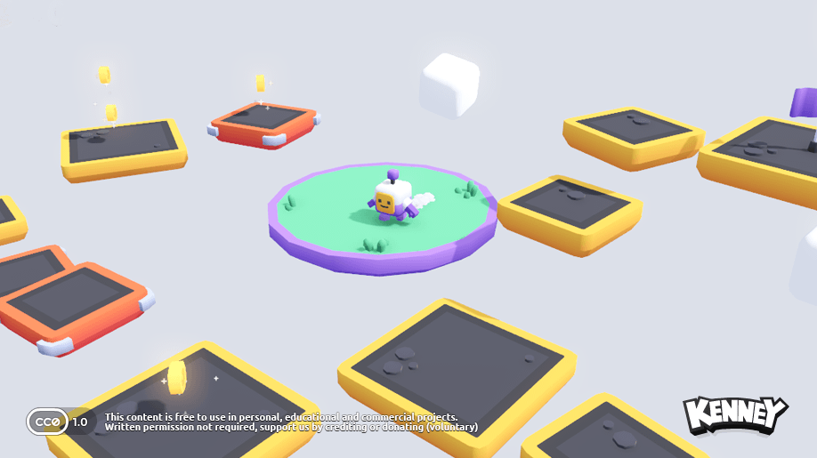

# My Notes:
What are Coins to be used for?
	Shuffle Deck
	Spawn 4 bugs on enemy place
	Buy Hearts / Heart Containers?
	Buy Stamina / Stamina Containers?
	Purchase a MarioKartBox with random powerup?

Fix the monster spawner, can't get to work for some reason.

The Arena could get more dangerous as you add cards? Or Per Ace, or Per Card, or Per King, or the danger is just per stack.

Make a stamina pickup.

When you die, instant respawn, cause a timer would be no fun.
	Instead a jail game to break out of or just a jump path to make it back to arena which will naturally cost you time

Bounce pad could be purchased with coins before you can use.
Coins that act like physics things, but still bob, and you can spawn a fountain of them from things
Big Spike?
Rotating circle path spike?
Something that spawns projectile?
Player can use stamina to dash forward attack. double dash into each other just bounces off.
	Maybe AOE knockback. Maybe MarioKartBox powerups?
Level Design could use work

Team based platforms? Enemy platforms fall away if you try touch them? Or other team based stuff?
Mostly it seems like mobility type stuff to get you to where you need to be.
And maybe stuff that might hinder the enemy? Slow-Down-BlobSlimes?

Have players right/left pick their team A or B, what about 3 or 4 team arenas?

Dropping off world should cost 1 heart. Death should have a respawn timer of 6 seconds?

Ground pound another player and they are stunned?
	Put a stars spinner around head, birdie tweeting stun sound?

Left Trigger to charge, player holds still, maybe shows arrow of dirrection, then your unleashed in a charge or roll that can damage during it

Remap triggers and change camera control style?

Goal / Target / Reserve / Pounce / Nertz Pile = 13 cards you must get rid of to win a round
Work / Build / Tableau Piles = Solitaire Pathes
Stock / Hand / Draw Pile = Remaining cards in players hand
Waste / Junk / Flip Pile = the cards you turn over from Stock
Foundation / Center / Field / Slap Piles (or Commons) = Community Stacks in middle

Make finished Kinged Piles slowly spawn coins, reason to return to that point, slowly the pot of coins gets rich
Make some other simple coin spawns
maybe 100 Coins will reshuffle your whole setup, excluding the ones in Field Piles

ground pounding another player, stuns them, takes 1 hp, and loses 6 coins around them.
	might be problem of chainstun gank, could bounce attacker way in air
	ground pound is limited heavily by stamina, so might be fine

### TODO:

Extend Deck behavior:
	TopFaceDown flag
	Dig Function (candig?)
	GameMaster Partial-Reshuffle after a timecountdown?

	There should also be some kind of positioning function, cause the Solitaire will use path3d, like the cards are laying partly on each other, but the other deck types will just be a stack.

	Each deck needs to remember what the player took, locking any further grabs, unless they drop that same card back.
		Or maybe some other drop of that card in field teleports the card back to its place.
		Otherwise if a legal placement is made somewhere, then deck is unlocked to be grabbed from

	SolitaireDeck
		gets 1 card at start of game, Face down untill game starts
		Empty can accept any card
		After than has to be opposite color and 1 rank lower
		Always face up cards
	FieldDeck
		Empty at start
		Empty can accept any Ace
		After that, only same suit and 1 rank higher
		Face down once completed with King
	GoalDeck
		dealt 13 cards at start
		all face down, Top card Face down untill game starts
	CycleDeck
		dealt 35 cards at start
		It's two decks and maybe a fast Press A action, something to signal it
		One deck is all facedown
		Other is all faceup
		We take set of 3 and place face up on other
		We can take whatever is top of faceup

### Stretch Goals:
Maybe a 2d Minimap, or just UI, to show what fieldstacks are at, possibly even team goal stack counts or score.
Make a 4 team area map.
Make an AI computer that is just a floating ghost that can pass through anything and take cards to stuff.

### Polish:
Music
Better SFX

### MVP Goals
Card can be:
	dropped on ground
		In which it's either laying flat (probably like a physics object), or doing the hoverbob floating?
	on a player (remembering the last place it was, to return if dropped)
	on a Goal Stack (13 pile, empty to win, must touch flag)
	on a Cycle Deck/Stack (3 at time, ground pound button to cycle)
	on a Solitaire Path (4x, Building down alternating, can be empty)
	on a Field Stack (out in middle)

Goal Stack, Cycle Stack, and Table Stack can probably be derivations (if that's possible) of some Deck type component
	Maybe even Solitaire Path can too, data wise, but display wise in the world the cards lay out along a path instead of stack.

each team of players has a 52 card playing deck and their own "Home Base" with the following:
starting setup that is shuffled and "dealt" randomly for each team:
	Goal stack of 13 (all face down, top can be flipped over with a ground pound only once round starts, if top is face up, it can be grabbed)
	Cycle stack of 35
	1 card face down (till game start) for each of the four Solitaire Paths

Grab will just be like, player is within the collision sphere, and is prompted with "[A] Grab Card" as long as they aren't holding anything presently, and A will grab the item, putting the card flat over the characters head, and maybe showing the 2d card on HUD. (Lock will show over the deck/stack it was taken from maybe, as you can't grab the card below if any, till that card is legally played or returned)
If player has a card, then going in collision spheres of places that it can be dropped will show like a hologram and prompt "[A] Place Card"

Cards legally played on Field Stacks are done, Field Stacks start empty, await an Ace, and must then be built up in Rank order for that Suit (by any team), and then are locked once the final rank, a King is played. those are positive points at end of round.
Cards played on a "Teams Home Base" Solitaire Paths can start with any Card of that teams, but must rank down and alternate color just like in solitaire. These are not worth points and just acts as a card storage to move the game, the player can pick up the top most card from any Solitaire Path (furthest on path as they lay out flat following the curve), and play that card legally on another solitaire path or take it to a legal field stack.
Cycle deck/stack is a face down deck of the 35 at start, a ground pound on a nearby button will take 3 off the top and put them face up stacked. the player can take the top and play it, or ground pound the button to deal another 3 on top of that, taking that top if he likes, and if he's able to play that card in field stacks or on solitaire paths, the next card below is now available to take off the cycle stack. Once the Deck is empty, ground pounding the button will flip that cycle stack, in it's order, face down to the deck, and deal 3 more cards just as before.

Picking up a card from the Goal, Cycle, or any of 4 solitaire paths, locks the next available card on that stack till player returns card in some manner or it is legally played somewhere else
So we need to indicate visually where to place cards
	Goal (starts with 13, top card face up once game has begun, player of that decks team can grab top card)
	Cycle (the left over 35 cards after we dealt the starting setup)
	Solitaire
	Table

Assets to make:
	Hologram Shader on a card to show where it goes down maybe when your near and A (activate) shows up for player
	Hologram animation emanating up kind of deal rectangle glow
	Stone Card Altar shapes
		Goal
		Cycle
		Table
		Solitaire? (Rounded puzzly so you can make curved path out of them?)

Glider Purchase with coins? Other abilities?
	LOL, actually if your holding a card, you can glide down, however it costs stamina? Might be slower, might be a wind direction that changes at times or ceases that will help or not, maybe bribes to change it.

Game Reset Controller:
	Shuffle and Deal 13, 1, 1, 1, 1, 35

Play Slot awaiting Ace and built up to King
	Fireworks when you place a king, spawns things around Table Arena

Team Play-Mat: Make this interesting circle prolly, then solitair stuff can be disconnected nearby
	A single 13-Deck slot
	4 array slots to play downward on
		Could be a thin stack, could be train tracks that move away from the base like tentacles and may be different based on the Table Arena layout.

Goal stacks could have effects, maybe rewards for each card placed there, some addition decision possibility.

Bribe the cannons to launch randomly at teams hills.

LOL, players have to run around and sort the cards afterwards. Just run around and tag them.

### Strech Goals

Main Menu, Pick teamcardbackimage

MiniMap / Global HUD: Play Slot
	Possibly so you can monitor Play Slots
	Each Team Jail-Cards
	Points in Play

Coins spent on map specials.
	Maybe you can rotate a platform that has 4 of the Play Slots on it so the one your watching is closer, cooldown before someone else can do it again.
	Move obstacles or monster spawners
	Curse certain suits or cards for whole map, run slower or stamina drain

##### Stamina thoughts
+basic stamina that fills bar not going over max
+basic stamina that gives a temporary container, used first
+basic stamina that gives a temporary container, used last
+faster regen for a time
+infinite for a time

# Starter Kit 3D Platformer

This package includes a basic template for a 3D platformer game in Godot 4.3 (stable). Includes features like;

- Character controller (with double jump)
- Collectable coins and falling platforms
- Camera controls (rotate, zoom)
- Gamepad support
- Sprites and 3D Models _(CC0 licensed)_
- Sound effects _(CC0 licensed)_

### Screenshot

### License

MIT License

Copyright (c) 2024 Kenney

Permission is hereby granted, free of charge, to any person obtaining a copy of this software and associated documentation files (the "Software"), to deal in the Software without restriction, including without limitation the rights to use, copy, modify, merge, publish, distribute, sublicense, and/or sell copies of the Software, and to permit persons to whom the Software is furnished to do so, subject to the following conditions:

The above copyright notice and this permission notice shall be included in all copies or substantial portions of the Software.

THE SOFTWARE IS PROVIDED "AS IS", WITHOUT WARRANTY OF ANY KIND, EXPRESS OR IMPLIED, INCLUDING BUT NOT LIMITED TO THE WARRANTIES OF MERCHANTABILITY, FITNESS FOR A PARTICULAR PURPOSE AND NONINFRINGEMENT. IN NO EVENT SHALL THE AUTHORS OR COPYRIGHT HOLDERS BE LIABLE FOR ANY CLAIM, DAMAGES OR OTHER LIABILITY, WHETHER IN AN ACTION OF CONTRACT, TORT OR OTHERWISE, ARISING FROM, OUT OF OR IN CONNECTION WITH THE SOFTWARE OR THE USE OR OTHER DEALINGS IN THE SOFTWARE.

Assets included in this package (2D sprites, 3D models and sound effects) are [CC0 licensed](https://creativecommons.org/publicdomain/zero/1.0/)
